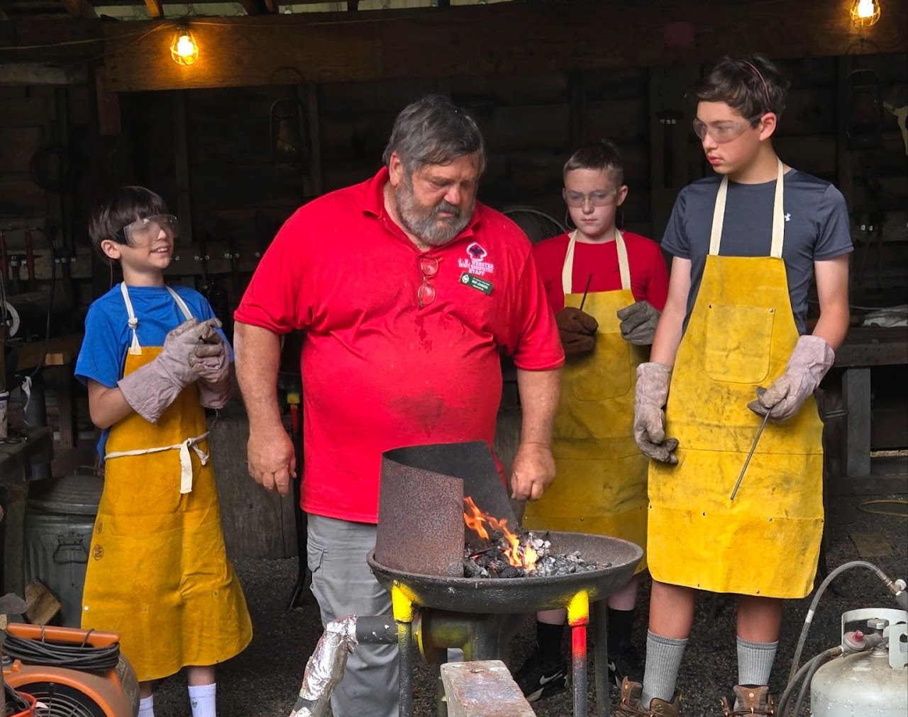
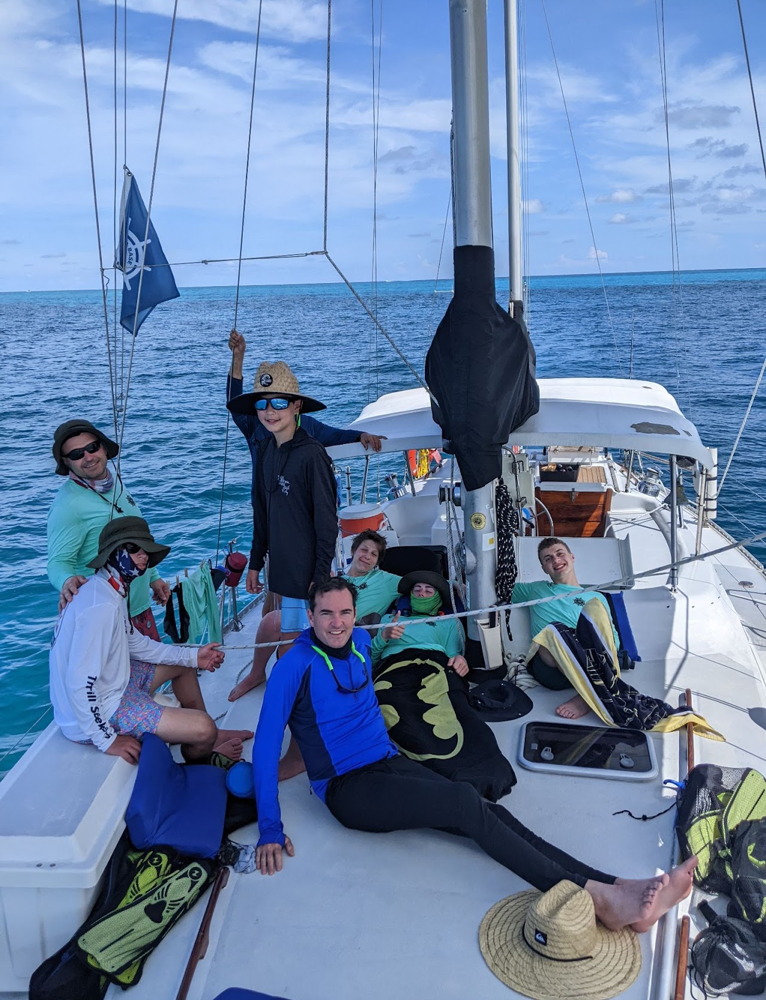

# Troop 48 · Lynnfield, Massachusetts

[Find Troop/Pack 48 on Facebook](https://www.facebook.com/search/top?q=scouting%20%26%20cub%20scouts%20(troop%2Fpack%2048%20-%20lynnfield%2C%20ma))

## Become a Merit Badge Counselor

Parent and adult volunteer toolkit for Troop 48, Lynnfield, Massachusetts, in Spirit of Adventure Council. Resources reviewed November 15, 2026; troop edition updated November 16, 2026.

Photos: [Lynnfield Troop 48 public website](https://sites.google.com/view/lynnfieldtroop48/home). [Photo source details](images/CREDITS.md).

[Interactive form and directory](https://cool-nerds.github.io/scouting-merit-badge-guide/counselor/) · [Printable full handbook](handbook.pdf) · [Accessible HTML handbook](handbook.html)

**This document does not certify anyone.** Council approves the counselor position and each badge, then maintains the official records. Examples below describe useful experience; they are not new requirements or a substitute for current policies.

## How to apply

1. Review the official requirements for each badge. Describe your education, work, practical experience and ability to teach and assess the whole subject.
2. Use your existing My.Scouting account. Keep Safeguarding Youth training current and complete counselor preparation.
3. Complete the official council information form, obtain the required approval, and follow the council registration route.
4. Submit the official paperwork and any qualification supplement yourself. Use council-directed channels for sensitive screening materials.
5. Wait for council confirmation of counselor registration and the specific approved badges. Verify your record in Scoutbook and maintain registration, training and credentials.

### Spirit of Adventure route

For leaders already registered in Spirit of Adventure: another unit Key 3 member approves the MBC form; email it to membership@scoutingboston.org. For adults not currently registered as leaders in this council: district advancement chair approval is required; send to that chair and membership. Complete SYT, the council CORI process and the online adult application council provides after receiving the form. The council lists $25 plus 3% administration for MBC-only registration; confirm any charge for your situation.

[Current membership instructions and district contacts](https://www.scoutingboston.org/membership/) · [Official council MBC form](https://www.scoutingboston.org/wp-content/uploads/2026/05/SoA-Merit-Badge-Counselor-Information.pdf) · [CORI process](https://www.scoutingboston.org/cori-information/)

The currently linked PDF retains older contact, fee and training language. Resolve inconsistencies with membership; the webpage supplies current submission routing. An applicant-created supplement cannot replace required official signatures or screening.

## Prepare a supplement

The [interactive form](https://cool-nerds.github.io/scouting-merit-badge-guide/counselor/#application) lets you select badges and record experience, certification level and dates, instructor partners, equipment and facilities, safety arrangements, gaps and availability. Download text or print the completed supplement to PDF. Attach it to official paperwork if accepted by council. There is no automatic submission, council integration or public applicant database. Do not enter SSNs, birth dates, medical records, CORI details, ID images or Scout information. Device saving is optional.

## Distinguish counselor, instructor and activity supervisor

An adult can be eligible to apply as a counselor at 18, while some activity supervisors must be 21 or older with specialized qualifications. Record who fills each role and who provides rescue or range safety coverage. A subject specialist may assist where policy permits; the approved counselor verifies the actual requirements. Strong subject experience is not a substitute for a required instructor rating.

## Teaching and safety

Use EDGE: Explain, Demonstrate, Guide, Enable. Each Scout performs their own required demonstrations, explanations and discussions. Do not add or remove requirements, award completion for mere attendance, or overlook individual assessment in group classes. Preserve actual completed requirements and partials. Use authorized processes for special-needs alternatives.

Follow [youth protection](https://www.scouting.org/health-and-safety/gss/gss01/) and its [FAQs](https://www.scouting.org/health-and-safety/yp-faqs/). No one-on-one adult–youth contact is allowed, including electronic communication. Arrange compliant adult staffing with unit leadership. Apply current safety, medical, site, weather, tool, permission and emergency-planning rules. A merit badge never authorizes an otherwise prohibited activity.

## Local help

Registration: membership@scoutingboston.org. [Council staff](https://www.scoutingboston.org/meet-the-staff/) lists the customer service center at 2 Tower Office Park, Woburn, and New England Base Camp at 411 Unquity Road, Milton; council phone 617-615-0004. [Scout Shop information](https://www.scoutingboston.org/scout-shop-v2/) lists Woburn at 2R Tower Office Park, 781-937-4282, and the Milton shop at Base Camp, 617-361-0315. Confirm current access before visiting. Shops provide supplies and resources; they do not grant counselor approval.

## Sources and scope

[National A–Z directory](https://www.scouting.org/skills/merit-badges/all/) · [Guide to Advancement, section 7](https://www.scouting.org/resources/guide-to-advancement/) · [Guide to Safe Scouting](https://www.scouting.org/health-and-safety/gss/) · [Aquatics policy](https://www.scouting.org/health-and-safety/gss/gss02/) · [Counselor resources](https://www.scouting.org/skills/merit-badges/counselor-information/) · [SYT](https://www.scouting.org/training/safeguarding-youth/) · [Scoutbook counselor guidance](https://help.scoutbook.scouting.org/knowledge-base/scoutbook-plus-merit-badge-counselor-guide/)

All 144 distinct entries in the national directory reviewed for this release are included: 143 current profiles and one transition entry. [Citizenship in Society was discontinued for new starts February 27, 2026](https://www.scouting.org/program-updates/citizenship-in-society-merit-badge-discontinuance/); council determines eligibility for existing work. [Test Lab proposals](https://www.scouting.org/skills/merit-badges/test-lab/) are linked separately. Recheck future additions and retirements. Experience suggestions and planning notes are original editorial guidance, not an official list of credentials required for every badge.

## All badge profiles

### American Business

**Careers & community · General counselor review**

**Experience you could describe:** Business ownership, accounting, management or business teaching.

**Plan and verify:** Help Scouts investigate business operations and ethics; use fictional financial examples rather than confidential employer records.

[Official American Business requirements and available pamphlet](https://www.scouting.org/merit-badges/american-business/)

### American Cultures

**Careers & community · General counselor review**

**Experience you could describe:** Cultural education, community organizing, history or sustained cross-cultural involvement.

**Plan and verify:** Arrange respectful interviews and approved visits; avoid stereotypes and treating one person as representing a whole culture.

[Official American Cultures requirements and available pamphlet](https://www.scouting.org/merit-badges/american-cultures/)

### American Heritage

**Careers & community · General counselor review**

**Experience you could describe:** History teaching, museum work, archival research or local history.

**Plan and verify:** Plan access to primary sources, historic places and individual research; separate evidence from opinion.

[Official American Heritage requirements and available pamphlet](https://www.scouting.org/merit-badges/american-heritage/)

### American Indian Culture

**Careers & community · General counselor review**

**Experience you could describe:** Relevant cultural scholarship, museum education or relationships with knowledgeable Indigenous educators.

**Plan and verify:** Use accurate, respectful, community-informed sources; confirm current name and requirements because the official listing uses a legacy URL.

[Official American Indian Culture requirements and available pamphlet](https://www.scouting.org/merit-badges/indian-lore/)

### American Labor

**Careers & community · General counselor review**

**Experience you could describe:** Labor history, human resources, skilled trades or labor relations.

**Plan and verify:** Present worker and employer perspectives fairly; arrange authorized interviews without sharing personnel information.

[Official American Labor requirements and available pamphlet](https://www.scouting.org/merit-badges/american-labor/)

### Animal Science

**Nature & environment · General counselor review**

**Experience you could describe:** Animal husbandry, farming, veterinary work or agricultural education.

**Plan and verify:** Plan safe livestock contact, sanitation, biosecurity and permission for farm visits; choose only permitted project options.

[Official Animal Science requirements and available pamphlet](https://www.scouting.org/merit-badges/animal-science/)

### Animation

**Arts & communication · General counselor review**

**Experience you could describe:** Animation, illustration, storyboarding or digital media production.

**Plan and verify:** Provide age-appropriate tools, individual production time and lawful use of music, images and software.

[Official Animation requirements and available pamphlet](https://www.scouting.org/merit-badges/animation/)

### Archaeology

**Nature & environment · General counselor review**

**Experience you could describe:** Archaeology, museum education or supervised fieldwork.

**Plan and verify:** Protect sites and cultural resources; obtain permissions and use authorized simulations or professionally supervised field opportunities.

[Official Archaeology requirements and available pamphlet](https://www.scouting.org/merit-badges/archaeology/)

### Archery

**Sports & adventure · Qualified range supervision**

**Experience you could describe:** Archery coaching, range work or organized instruction.

**Plan and verify:** Arrange a permitted range, appropriate bows, eye and line safety, and qualified range supervision under current national policies.

[Official Archery requirements and available pamphlet](https://www.scouting.org/merit-badges/archery/)

### Architecture

**STEM & trades · General counselor review**

**Experience you could describe:** Architecture, building design, drafting or architectural education.

**Plan and verify:** Arrange safe site access, accessible drawing tools and consent for professional interviews; construction sites require permission and supervision.

[Official Architecture requirements and available pamphlet](https://www.scouting.org/merit-badges/architecture/)

### Art

**Arts & communication · General counselor review**

**Experience you could describe:** Drawing, painting, visual arts instruction or studio practice.

**Plan and verify:** Provide safe media and ventilation; allow each Scout to create and discuss original work.

[Official Art requirements and available pamphlet](https://www.scouting.org/merit-badges/art/)

### Artificial Intelligence

**STEM & trades · General counselor review**

**Experience you could describe:** AI education, machine learning, software engineering or responsible AI use.

**Plan and verify:** Plan age-appropriate accounts, privacy-safe sample data and discussion of accuracy, bias and attribution; do not enter youth personal data into public AI tools.

[Official Artificial Intelligence requirements and available pamphlet](https://www.scouting.org/merit-badges/artificial-intelligence/)

### Astronomy

**Nature & environment · General counselor review**

**Experience you could describe:** Amateur astronomy, observatory work or science teaching.

**Plan and verify:** Provide safe night observation and weather alternatives; never permit unfiltered solar viewing.

[Official Astronomy requirements and available pamphlet](https://www.scouting.org/merit-badges/astronomy/)

### Athletics

**Sports & adventure · General counselor review**

**Experience you could describe:** Track and field coaching, physical education or athletic training.

**Plan and verify:** Review health and conditioning, warm-up, weather and safe equipment; follow the actual improvement and tracking requirements.

[Official Athletics requirements and available pamphlet](https://www.scouting.org/merit-badges/athletics/)

### Automotive Maintenance

**STEM & trades · General counselor review**

**Experience you could describe:** Vehicle repair, automotive teaching or extensive safe maintenance experience.

**Plan and verify:** Plan controlled work areas, ventilation, fluid disposal and appropriate tools; prevent unsupported vehicles, hot-system injuries and youth operation of prohibited equipment.

[Official Automotive Maintenance requirements and available pamphlet](https://www.scouting.org/merit-badges/automotive-maintenance/)

### Aviation

**STEM & trades · General counselor review**

**Experience you could describe:** Piloting, aircraft maintenance, aerospace work or aviation education.

**Plan and verify:** Separate badge counseling from flight operation; verify pilot, aircraft, airport permissions and current Scouting aviation policies for any flight option.

[Official Aviation requirements and available pamphlet](https://www.scouting.org/merit-badges/aviation/)

### Backpacking

**Sports & adventure · General counselor review**

**Experience you could describe:** Backcountry trip leadership and experience teaching packing, navigation and low-impact travel.

**Plan and verify:** Plan routes, weather, fitness, water, permits and emergency communication; record actual required outings and distances.

[Official Backpacking requirements and available pamphlet](https://www.scouting.org/merit-badges/backpacking/)

### Basketry

**Arts & communication · General counselor review**

**Experience you could describe:** Basketmaking, fiber arts or craft instruction.

**Plan and verify:** Provide suitable materials, tool safety and enough time for each Scout to make the required items.

[Official Basketry requirements and available pamphlet](https://www.scouting.org/merit-badges/basketry/)

### Bird Study

**Nature & environment · General counselor review**

**Experience you could describe:** Birding, ornithology or field ecology.

**Plan and verify:** Plan ethical observation, individual identification records and safe field access; avoid disturbing nests or wildlife.

[Official Bird Study requirements and available pamphlet](https://www.scouting.org/merit-badges/bird-study/)

### Bugling

**Arts & communication · General counselor review**

**Experience you could describe:** Bugle or brass playing and music instruction.

**Plan and verify:** Arrange a suitable instrument and hearing-conscious practice space; evaluate each required call individually.

[Official Bugling requirements and available pamphlet](https://www.scouting.org/merit-badges/bugling/)

### Camping

**Sports & adventure · General counselor review**

**Experience you could describe:** Outdoor leadership, campcraft and youth camping instruction.

**Plan and verify:** Check which nights and activities count; plan safe overnight supervision, sanitation, equipment and weather contingencies.

[Official Camping requirements and available pamphlet](https://www.scouting.org/merit-badges/camping/)

### Canoeing

**Aquatics · Aquatics qualification review**

**Experience you could describe:** Canoe instruction, paddling leadership and documented rescue competence.

**Plan and verify:** Equipment and waterfront access support an application but do not establish instructional competence. Plan swimmer testing, life jackets, rescue coverage and an approved water venue.

**Swimmer test, not the Swimming badge:** Scouts must pass the Scouting America swimmer test before the subsequent Canoeing requirements. The Swimming merit badge is not a prerequisite. For your application, describe canoe instruction, strokes, tandem and solo skills, capsize recovery, rescues and risk management—not just boat ownership. GTA 7.0.1.1 identifies canoe-related training routes, including Aquatics Instructor, council-approved canoe training such as Paddlecraft Safety, and ACA canoe instructor training; council can consider comparable experience. Ask the council aquatics and advancement reviewers to assess your record. For sessions, arrange Safety Afloat supervision, swimmer classification, appropriate life jackets, a safe venue, rescue coverage and weather and emergency plans.

[Official reference](https://www.scouting.org/merit-badges/canoeing/) · [Official reference](https://www.scouting.org/resources/guide-to-advancement/) · [Official reference](https://www.scouting.org/health-and-safety/gss/gss02/)

[Official Canoeing requirements and available pamphlet](https://www.scouting.org/merit-badges/canoeing/)

### Chemistry

**STEM & trades · General counselor review**

**Experience you could describe:** Chemistry teaching, laboratory work or chemical engineering.

**Plan and verify:** Use age-appropriate permitted experiments, protective equipment, ventilation and proper waste handling; obtain facility approval.

[Official Chemistry requirements and available pamphlet](https://www.scouting.org/merit-badges/chemistry/)

### Chess

**Arts & communication · General counselor review**

**Experience you could describe:** Chess playing, coaching, tournament participation or teaching.

**Plan and verify:** Provide boards, accessible instruction and opportunities for each Scout to play, analyze and explain rather than only watch.

[Official Chess requirements and available pamphlet](https://www.scouting.org/merit-badges/chess/)

### Citizenship in Society

**Careers & community · Transition only — no new starts**

**Experience you could describe:** Prior council-approved counseling and appropriate facilitation experience.

**Plan and verify:** Discontinued for new starts February 27, 2026. Consult council about eligible existing work and the official transition notice; do not recruit new starts.

[Official Citizenship in Society requirements and available pamphlet](https://www.scouting.org/merit-badges/citizenship-in-society/)

### Citizenship in the Community

**Careers & community · General counselor review**

**Experience you could describe:** Community service, municipal work, civic education or nonprofit leadership.

**Plan and verify:** Arrange permitted visits and meaningful service, respect political differences and confirm the required approvals before projects.

[Official Citizenship in the Community requirements and available pamphlet](https://www.scouting.org/merit-badges/citizenship-in-the-community/)

### Citizenship in the Nation

**Careers & community · General counselor review**

**Experience you could describe:** Government, history, civic education or public service.

**Plan and verify:** Support individual research and civic discussion; separate civic learning from partisan campaigning.

[Official Citizenship in the Nation requirements and available pamphlet](https://www.scouting.org/merit-badges/citizenship-in-the-nation/)

### Citizenship in the World

**Careers & community · General counselor review**

**Experience you could describe:** International affairs, geography, history, diplomacy or global education.

**Plan and verify:** Use reliable current sources, respectful discussion and safe approved contacts; do not require travel beyond the actual requirements.

[Official Citizenship in the World requirements and available pamphlet](https://www.scouting.org/merit-badges/citizenship-in-the-world/)

### Climbing

**Sports & adventure · Qualified climbing supervision**

**Experience you could describe:** Climbing instruction, technical rescue or substantial supervised climbing teaching.

**Plan and verify:** Arrange qualified climbing supervision, inspected systems, suitable site and emergency response; personal recreational climbing alone is not a complete staffing plan.

[Official Climbing requirements and available pamphlet](https://www.scouting.org/merit-badges/climbing/)

### Coin Collecting

**Arts & communication · General counselor review**

**Experience you could describe:** Numismatics, collecting or coin history education.

**Plan and verify:** Provide safe handling and research resources; avoid pressuring Scouts to buy expensive items or using appraisals as financial advice.

[Official Coin Collecting requirements and available pamphlet](https://www.scouting.org/merit-badges/coin-collecting/)

### Collections

**Arts & communication · General counselor review**

**Experience you could describe:** Curating, collecting, conservation or museum work.

**Plan and verify:** Use accessible collections, lawful acquisition and careful handling; respect the badge’s exclusions and individual project requirements.

[Official Collections requirements and available pamphlet](https://www.scouting.org/merit-badges/collections/)

### Communication

**Arts & communication · General counselor review**

**Experience you could describe:** Teaching, public relations, journalism, facilitation or communication work.

**Plan and verify:** Plan individual speaking, listening and organizing tasks; obtain permission for recordings and protect personal information.

[Official Communication requirements and available pamphlet](https://www.scouting.org/merit-badges/communication/)

### Competitive Gaming

**Arts & communication · General counselor review**

**Experience you could describe:** Organized gaming, esports coaching or game community education.

**Plan and verify:** Use age-appropriate games and accounts, supervised online interaction, healthy time limits and good sportsmanship.

[Official Competitive Gaming requirements and available pamphlet](https://www.scouting.org/merit-badges/competitive-gaming/)

### Composite Materials

**STEM & trades · General counselor review**

**Experience you could describe:** Composite fabrication, materials engineering or trained shop instruction.

**Plan and verify:** Plan resin and solvent safety, dust controls, protective equipment and permitted age-appropriate tools.

[Official Composite Materials requirements and available pamphlet](https://www.scouting.org/merit-badges/composite-materials/)

### Cooking

**Life skills & service · General counselor review**

**Experience you could describe:** Home or professional cooking, food safety instruction or outdoor meal leadership.

**Plan and verify:** Plan separate home, camp and trail tasks; address allergens, food storage, budgets, stove safety and the rules on reusing meals or menus.

**Good cooking includes planning, nutrition and safe outdoor practice:** Describe experience teaching food handling, meal planning, nutrition, budgeting, home cooking and outdoor stove or fire methods. A professional chef title is evidence of experience, not automatic council approval. Plan allergy and cross-contamination controls and age-appropriate knife, heat and fuel supervision. The badge has distinct home, camp and trail components. Meals counted for Cooking cannot also count for rank or other badges, and the specified menu groups cannot simply be repeated. Review the current requirement text for meal counts, methods, group sizes, approval and evaluation. A single troop dinner will not demonstrate the whole badge.

[Official reference](https://www.scouting.org/merit-badges/cooking/) · [Official reference](https://www.scouting.org/health-and-safety/gss/gss06/)

[Official Cooking requirements and available pamphlet](https://www.scouting.org/merit-badges/cooking/)

### Crime Prevention

**Careers & community · General counselor review**

**Experience you could describe:** Public safety, community prevention work, law or civic education.

**Plan and verify:** Use safe observation and approved interviews; never ask Scouts to investigate suspects or enter dangerous situations.

[Official Crime Prevention requirements and available pamphlet](https://www.scouting.org/merit-badges/crime-prevention/)

### Cybersecurity

**STEM & trades · General counselor review**

**Experience you could describe:** Information security, IT administration, software security or cyber education.

**Plan and verify:** Use authorized training systems only; protect credentials and youth data and prohibit unauthorized probing of real systems.

[Official Cybersecurity requirements and available pamphlet](https://www.scouting.org/merit-badges/cybersecurity/)

### Cycling

**Sports & adventure · General counselor review**

**Experience you could describe:** Bicycle instruction, maintenance, road riding leadership or trail coaching.

**Plan and verify:** Check current route options, bicycle condition, helmets, traffic rules, health, distances and supervision; do not substitute unrequired distances.

[Official Cycling requirements and available pamphlet](https://www.scouting.org/merit-badges/cycling/)

### Dentistry

**Life skills & service · General counselor review**

**Experience you could describe:** Dental care, dental education or supervised oral-health instruction.

**Plan and verify:** Use models and approved demonstrations; protect patient confidentiality and arrange consent for any clinical observation.

[Official Dentistry requirements and available pamphlet](https://www.scouting.org/merit-badges/dentistry/)

### Digital Technology

**STEM & trades · General counselor review**

**Experience you could describe:** IT support, computing education, digital systems or technology work.

**Plan and verify:** Provide safe accounts, lawful software, privacy controls and individual demonstrations; obtain approval before publishing work.

[Official Digital Technology requirements and available pamphlet](https://www.scouting.org/merit-badges/digital-technology/)

### Disabilities Awareness

**Life skills & service · General counselor review**

**Experience you could describe:** Accessibility, disability advocacy, special education or relevant lived experience.

**Plan and verify:** Use respectful, consent-based learning and accessible activities; avoid assumptions about a person’s abilities or disclosure of health information.

[Official Disabilities Awareness requirements and available pamphlet](https://www.scouting.org/merit-badges/disabilities-awareness/)

### Dog Care

**Nature & environment · General counselor review**

**Experience you could describe:** Responsible dog training, veterinary work or substantial dog husbandry.

**Plan and verify:** Plan safe handling, bite prevention, sanitation and actual care records; do not require contact with an unsuitable animal.

[Official Dog Care requirements and available pamphlet](https://www.scouting.org/merit-badges/dog-care/)

### Drafting

**STEM & trades · General counselor review**

**Experience you could describe:** Technical drafting, CAD, engineering drawing or design teaching.

**Plan and verify:** Provide lawful software or manual tools and help each Scout produce and explain required drawings.

[Official Drafting requirements and available pamphlet](https://www.scouting.org/merit-badges/drafting/)

### Electricity

**STEM & trades · General counselor review**

**Experience you could describe:** Electrical trades, electrical engineering or safe electrical instruction.

**Plan and verify:** Use de-energized or suitable low-voltage demonstrations; licensed work and hazardous systems require appropriate professionals and permissions.

[Official Electricity requirements and available pamphlet](https://www.scouting.org/merit-badges/electricity/)

### Electronics

**STEM & trades · General counselor review**

**Experience you could describe:** Electronics repair, engineering, radio construction or circuit instruction.

**Plan and verify:** Plan low-voltage circuits, soldering ventilation, eye protection and safe battery handling; no exposed mains-voltage work by unqualified youth.

[Official Electronics requirements and available pamphlet](https://www.scouting.org/merit-badges/electronics/)

### Emergency Preparedness

**Life skills & service · General counselor review**

**Experience you could describe:** Emergency management, response planning or disaster-readiness education.

**Plan and verify:** Check First Aid badge and other required components; use safe simulations rather than real hazardous incidents and coordinate with unit emergency plans.

[Official Emergency Preparedness requirements and available pamphlet](https://www.scouting.org/merit-badges/emergency-preparedness/)

### Energy

**STEM & trades · General counselor review**

**Experience you could describe:** Energy engineering, utilities, sustainability or science education.

**Plan and verify:** Use safe audits and models; obtain permission for facility tours and avoid energized equipment or rooftop access.

[Official Energy requirements and available pamphlet](https://www.scouting.org/merit-badges/energy/)

### Engineering

**STEM & trades · General counselor review**

**Experience you could describe:** Engineering practice, technical design or engineering education.

**Plan and verify:** Support age-appropriate design, testing and explanation; plan safe tools and distinguish prototypes from structures approved for human use.

[Official Engineering requirements and available pamphlet](https://www.scouting.org/merit-badges/engineering/)

### Entrepreneurship

**Careers & community · General counselor review**

**Experience you could describe:** Business startup experience, mentoring or business education.

**Plan and verify:** Plan realistic costs and ethical sales, adult permission and youth privacy; avoid requiring Scouts to assume debt or financial risk.

[Official Entrepreneurship requirements and available pamphlet](https://www.scouting.org/merit-badges/entrepreneurship/)

### Environmental Science

**Nature & environment · General counselor review**

**Experience you could describe:** Environmental science, ecology, environmental engineering or science teaching.

**Plan and verify:** Plan genuine field observation and experiments with safe sites and accurate records; choose the required options and durations.

[Official Environmental Science requirements and available pamphlet](https://www.scouting.org/merit-badges/environmental-science/)

### Exploration

**Sports & adventure · General counselor review**

**Experience you could describe:** Field science, expedition planning, research or outdoor education.

**Plan and verify:** Approve a realistic investigation and plan access, permissions, equipment, weather and emergency procedures.

[Official Exploration requirements and available pamphlet](https://www.scouting.org/merit-badges/exploration/)

### Family Life

**Life skills & service · General counselor review**

**Experience you could describe:** Family education, parenting, social services or youth mentoring.

**Plan and verify:** Respect varied family structures and sensitive discussions; check required tracking periods and project approvals without collecting private family details.

[Official Family Life requirements and available pamphlet](https://www.scouting.org/merit-badges/family-life/)

### Farm Mechanics

**STEM & trades · General counselor review**

**Experience you could describe:** Farm equipment maintenance, mechanical trades or agricultural instruction.

**Plan and verify:** Control stored energy, hydraulics, machinery and fluids; use only age-permitted tools with appropriate guards and supervision.

[Official Farm Mechanics requirements and available pamphlet](https://www.scouting.org/merit-badges/farm-mechanics/)

### Fingerprinting

**Life skills & service · General counselor review**

**Experience you could describe:** Forensics, fingerprint work or science education.

**Plan and verify:** Use consent-based practice, safe materials and proper disposal; do not publish fingerprints or treat practice prints as background checks.

[Official Fingerprinting requirements and available pamphlet](https://www.scouting.org/merit-badges/fingerprinting/)

### Fire Safety

**Life skills & service · General counselor review**

**Experience you could describe:** Fire prevention, firefighting, safety inspection or fire education.

**Plan and verify:** Arrange approved visits and safe demonstrations; do not expose youth to live fire operations or unsupported rescue scenarios.

[Official Fire Safety requirements and available pamphlet](https://www.scouting.org/merit-badges/fire-safety/)

### First Aid

**Life skills & service · Qualified CPR instruction**

**Experience you could describe:** Current first aid education, emergency care, nursing, medicine or trained first aid instruction.

**Plan and verify:** Plan current skill instruction, safe simulations, training mannequins and individual demonstrations; CPR instruction requires a currently qualified CPR instructor.

**Care experience and CPR instructor authority are separate:** Describe current first aid education, practical experience and ability to teach safe, age-appropriate skills. Health care employment or a CPR provider card does not by itself establish CPR instructor qualification. The GTA requires CPR instruction to be given by a currently trained CPR instructor from a nationally certified provider. Arrange that instructor where required. Use approved training devices, safe role play, infection-control precautions and individual demonstrations. Badge completion does not itself award a professional first aid or CPR certification. Use current badge requirements rather than an old rank-prerequisite checklist.

[Official reference](https://www.scouting.org/merit-badges/first-aid/) · [Official reference](https://www.scouting.org/resources/guide-to-advancement/)

[Official First Aid requirements and available pamphlet](https://www.scouting.org/merit-badges/first-aid/)

### Fish & Wildlife Management

**Nature & environment · General counselor review**

**Experience you could describe:** Wildlife biology, conservation, habitat management or environmental education.

**Plan and verify:** Arrange lawful, ethical observation and projects; check permits, landowner consent and restrictions on handling wildlife.

[Official Fish & Wildlife Management requirements and available pamphlet](https://www.scouting.org/merit-badges/fish-wildlife-management/)

### Fishing

**Sports & adventure · General counselor review**

**Experience you could describe:** Angling instruction, fisheries work or sustained fishing experience.

**Plan and verify:** Plan hook safety, water supervision, licenses, species rules, ethical handling and food safety if fish are prepared.

[Official Fishing requirements and available pamphlet](https://www.scouting.org/merit-badges/fishing/)

### Fly Fishing

**Sports & adventure · General counselor review**

**Experience you could describe:** Fly angling instruction, fly tying or fisheries education.

**Plan and verify:** Plan casting zones, hook and eye safety, safe wading, water supervision and current fishing rules.

[Official Fly Fishing requirements and available pamphlet](https://www.scouting.org/merit-badges/fly-fishing/)

### Forestry

**Nature & environment · General counselor review**

**Experience you could describe:** Forestry, arboriculture, woodland management or tree identification.

**Plan and verify:** Arrange safe field sites and identification practice; do not assume forestry experience authorizes Scouts to use chainsaws or hazardous logging tools.

[Official Forestry requirements and available pamphlet](https://www.scouting.org/merit-badges/forestry/)

### Game Design

**Arts & communication · General counselor review**

**Experience you could describe:** Game development, design teaching or extensive tabletop or digital design.

**Plan and verify:** Allow each Scout to design, test and revise; protect intellectual property and use age-appropriate content and accounts.

[Official Game Design requirements and available pamphlet](https://www.scouting.org/merit-badges/game-design/)

### Gardening

**Nature & environment · General counselor review**

**Experience you could describe:** Horticulture, gardening, agriculture or garden education.

**Plan and verify:** Plan growing seasons, safe tools, soil hygiene and allergy controls; record actual observations and project progress.

[Official Gardening requirements and available pamphlet](https://www.scouting.org/merit-badges/gardening/)

### Genealogy

**Careers & community · General counselor review**

**Experience you could describe:** Family-history research, archives, librarianship or genealogy instruction.

**Plan and verify:** Use consent-based family research and credible records; protect living relatives’ identities and accommodate unknown or sensitive family histories.

[Official Genealogy requirements and available pamphlet](https://www.scouting.org/merit-badges/genealogy/)

### Geocaching

**Sports & adventure · General counselor review**

**Experience you could describe:** Geocaching, navigation or outdoor instruction.

**Plan and verify:** Plan legal access, safe routes, device use and appropriate cache placement; avoid trespass and hazardous locations.

[Official Geocaching requirements and available pamphlet](https://www.scouting.org/merit-badges/geocaching/)

### Geology

**Nature & environment · General counselor review**

**Experience you could describe:** Geology, earth science, mining education or field study.

**Plan and verify:** Use stable permitted sites, safe sample collection and eye protection; avoid active machinery and unstable rock faces.

[Official Geology requirements and available pamphlet](https://www.scouting.org/merit-badges/geology/)

### Golf

**Sports & adventure · General counselor review**

**Experience you could describe:** Golf coaching, golf participation or course instruction.

**Plan and verify:** Arrange course permission, safe swing spacing, weather plans and the correct current sport option and play requirements.

[Official Golf requirements and available pamphlet](https://www.scouting.org/merit-badges/golf/)

### Graphic Arts

**Arts & communication · General counselor review**

**Experience you could describe:** Printing, graphic design, publishing or visual communication.

**Plan and verify:** Provide lawful design assets and safe production tools; arrange individual design and printing work using the required processes.

[Official Graphic Arts requirements and available pamphlet](https://www.scouting.org/merit-badges/graphic-arts/)

### Health Care Professions

**Life skills & service · General counselor review**

**Experience you could describe:** Health care practice, clinical education or health career counseling.

**Plan and verify:** Arrange approved professional interviews and safe observation; protect patients and do not let youth provide unauthorized clinical care.

[Official Health Care Professions requirements and available pamphlet](https://www.scouting.org/merit-badges/health-care-professions/)

### Hiking

**Sports & adventure · General counselor review**

**Experience you could describe:** Hiking leadership, outdoor navigation or trail education.

**Plan and verify:** Review required hike sequence and distances, fitness, footwear, navigation, weather and emergency plans.

[Official Hiking requirements and available pamphlet](https://www.scouting.org/merit-badges/hiking/)

### Home Repairs

**STEM & trades · General counselor review**

**Experience you could describe:** Home maintenance, building trades or safe repair instruction.

**Plan and verify:** Choose permitted tasks, isolate hazards and plan appropriate tools; qualified professionals handle dangerous electrical or structural work.

[Official Home Repairs requirements and available pamphlet](https://www.scouting.org/merit-badges/home-repairs/)

### Horsemanship

**Sports & adventure · General counselor review**

**Experience you could describe:** Riding instruction, equine care or supervised horse handling.

**Plan and verify:** Use suitable horses, qualified supervision, helmets, safe facilities and an appropriate emergency plan; ownership alone is insufficient.

[Official Horsemanship requirements and available pamphlet](https://www.scouting.org/merit-badges/horsemanship/)

### Insect Study

**Nature & environment · General counselor review**

**Experience you could describe:** Entomology, biology, gardening education or insect observation.

**Plan and verify:** Plan ethical collection or observation, bite and allergy precautions and safe habitat access.

[Official Insect Study requirements and available pamphlet](https://www.scouting.org/merit-badges/insect-study/)

### Inventing

**STEM & trades · General counselor review**

**Experience you could describe:** Product design, prototyping, invention or design education.

**Plan and verify:** Plan a safe prototype and individual design process; discuss intellectual property without requiring expensive patent filings.

[Official Inventing requirements and available pamphlet](https://www.scouting.org/merit-badges/inventing/)

### Journalism

**Arts & communication · General counselor review**

**Experience you could describe:** Reporting, editing, broadcasting or journalism teaching.

**Plan and verify:** Plan ethical sourcing, interviews and permission for publication; protect youth identities and distinguish facts from opinion.

[Official Journalism requirements and available pamphlet](https://www.scouting.org/merit-badges/journalism/)

### Kayaking

**Aquatics · Aquatics qualification review**

**Experience you could describe:** Kayak instruction, paddling leadership and rescue training.

**Plan and verify:** Plan suitable craft, swimmer testing, properly fitted life jackets and practiced rescue support; flatwater experience does not establish whitewater competence.

[Official Kayaking requirements and available pamphlet](https://www.scouting.org/merit-badges/kayaking/)

### Landscape Architecture

**STEM & trades · General counselor review**

**Experience you could describe:** Landscape architecture, site design, horticulture or planning.

**Plan and verify:** Arrange permitted site analysis, accessible drawing tools and safe field visits; protect private site information.

[Official Landscape Architecture requirements and available pamphlet](https://www.scouting.org/merit-badges/landscape-architecture/)

### Law

**Careers & community · General counselor review**

**Experience you could describe:** Legal practice, legal education, court work or civic education.

**Plan and verify:** Arrange permitted visits or interviews; use educational examples and protect confidential case information.

[Official Law requirements and available pamphlet](https://www.scouting.org/merit-badges/law/)

### Leatherwork

**Arts & communication · General counselor review**

**Experience you could describe:** Leathercraft, saddlery or craft teaching.

**Plan and verify:** Provide safe cutting and punching tools, ventilation for adhesives and individual construction time.

[Official Leatherwork requirements and available pamphlet](https://www.scouting.org/merit-badges/leatherwork/)

### Lifesaving

**Aquatics · Aquatics qualification review**

**Experience you could describe:** Aquatics instruction, lifeguard instruction or equivalent rescue teaching.

**Plan and verify:** Plan current qualified supervision and rescue practice with appropriate equipment; the badge does not itself certify a professional lifeguard.

[Official Lifesaving requirements and available pamphlet](https://www.scouting.org/merit-badges/lifesaving/)

### Mammal Study

**Nature & environment · General counselor review**

**Experience you could describe:** Mammalogy, wildlife biology or naturalist education.

**Plan and verify:** Use ethical observation, safe habitat projects and hygiene; do not handle wild mammals or enter unsafe dens.

[Official Mammal Study requirements and available pamphlet](https://www.scouting.org/merit-badges/mammal-study/)

### Metalwork

**STEM & trades · General counselor review**

**Experience you could describe:** Metal fabrication, machining, jewelry work or trained shop instruction.

**Plan and verify:** Plan the chosen process, heat and eye protection, ventilation and age-permitted equipment; separate this work from welding qualifications.

[Official Metalwork requirements and available pamphlet](https://www.scouting.org/merit-badges/metalwork/)

### Military Service and Veterans

**Careers & community · General counselor review**

**Experience you could describe:** Military service, veterans support, military history or civic education.

**Plan and verify:** Arrange respectful voluntary interviews and safe authorized visits; avoid soliciting traumatic disclosures or exposing personal service records.

[Official Military Service and Veterans requirements and available pamphlet](https://www.scouting.org/merit-badges/military-service-veterans/)

### Mining in Society

**STEM & trades · General counselor review**

**Experience you could describe:** Mining, geology, minerals industry or mining education.

**Plan and verify:** Plan authorized tours, protective equipment and environmental discussion; do not enter abandoned mines.

[Official Mining in Society requirements and available pamphlet](https://www.scouting.org/merit-badges/mining-in-society/)

### Model Design and Building

**STEM & trades · General counselor review**

**Experience you could describe:** Modelmaking, industrial design, engineering or craft instruction.

**Plan and verify:** Provide safe materials, scale planning, tool instruction and individual design and construction opportunities.

[Official Model Design and Building requirements and available pamphlet](https://www.scouting.org/merit-badges/model-design-and-building/)

### Motorboating

**Aquatics · Aquatics qualification review**

**Experience you could describe:** Powerboat instruction, boating education and practical boat handling.

**Plan and verify:** Confirm applicable operator laws, suitable craft, swimmer testing, life jackets, fuel and propeller safety and rescue coverage.

[Official Motorboating requirements and available pamphlet](https://www.scouting.org/merit-badges/motorboating/)

### Moviemaking

**Arts & communication · General counselor review**

**Experience you could describe:** Film, video production, editing or media teaching.

**Plan and verify:** Plan permissions, safe locations, lawful music and image use, and privacy for everyone recorded.

[Official Moviemaking requirements and available pamphlet](https://www.scouting.org/merit-badges/moviemaking/)

### Multisport

**Sports & adventure · Multiple sport safety plans**

**Experience you could describe:** Multisport coaching, endurance sports, aquatics or athletic instruction.

**Plan and verify:** Review the actual swim, cycling and running options, transitions, conditioning and sport-specific supervision; do not treat the badge as approval for any race.

[Official Multisport requirements and available pamphlet](https://www.scouting.org/merit-badges/multisport/)

### Music

**Arts & communication · General counselor review**

**Experience you could describe:** Instrumental or vocal performance, composition or music teaching.

**Plan and verify:** Provide accessible instruments, hearing-conscious practice and individual performance or project opportunities.

[Official Music requirements and available pamphlet](https://www.scouting.org/merit-badges/music/)

### Nature

**Nature & environment · General counselor review**

**Experience you could describe:** Natural history, ecology or outdoor education.

**Plan and verify:** Plan safe field observations, ethical study and required topic choices; avoid disturbance or unauthorized collecting.

[Official Nature requirements and available pamphlet](https://www.scouting.org/merit-badges/nature/)

### Nuclear Science

**STEM & trades · General counselor review**

**Experience you could describe:** Nuclear science, radiation protection, physics or science education.

**Plan and verify:** Use safe models and approved demonstrations; do not expose Scouts to unapproved radiation sources or restricted facilities.

[Official Nuclear Science requirements and available pamphlet](https://www.scouting.org/merit-badges/nuclear-science/)

### Oceanography

**Nature & environment · General counselor review**

**Experience you could describe:** Marine science, oceanography or marine education.

**Plan and verify:** Arrange safe coastal observations and experiments; plan tides, weather and aquatics supervision for any water activity.

[Official Oceanography requirements and available pamphlet](https://www.scouting.org/merit-badges/oceanography/)

### Orienteering

**Sports & adventure · General counselor review**

**Experience you could describe:** Navigation instruction, orienteering events or map education.

**Plan and verify:** Plan boundaries, buddy procedures, course checks, weather and lost-person response; verify actual navigation skills.

[Official Orienteering requirements and available pamphlet](https://www.scouting.org/merit-badges/orienteering/)

### Painting

**STEM & trades · General counselor review**

**Experience you could describe:** Painting trades, finishing, conservation or painting instruction.

**Plan and verify:** Control fumes, solvents, surface preparation and ladder hazards; use suitable materials and appropriate cleanup.

[Official Painting requirements and available pamphlet](https://www.scouting.org/merit-badges/painting/)

### Personal Fitness

**Life skills & service · General counselor review**

**Experience you could describe:** Physical education, fitness coaching, health education or relevant training.

**Plan and verify:** Review current health-related requirements and the actual tracking period; use individual goals and protect medical information.

[Official Personal Fitness requirements and available pamphlet](https://www.scouting.org/merit-badges/personal-fitness/)

### Personal Management

**Life skills & service · General counselor review**

**Experience you could describe:** Budgeting, finance education, project management or household financial management.

**Plan and verify:** Use privacy-conscious budgeting and time-management records; avoid investment sales, disclosure of family finances or extra requirements.

[Official Personal Management requirements and available pamphlet](https://www.scouting.org/merit-badges/personal-management/)

### Pets

**Nature & environment · General counselor review**

**Experience you could describe:** Responsible animal care, veterinary work or animal education.

**Plan and verify:** Plan humane handling, sanitation, allergies and sustained care records; avoid unsuitable animal interactions.

[Official Pets requirements and available pamphlet](https://www.scouting.org/merit-badges/pets/)

### Photography

**Arts & communication · General counselor review**

**Experience you could describe:** Photography, visual storytelling or photography instruction.

**Plan and verify:** Plan lawful locations, image consent, privacy and equipment safety; each Scout creates their own work.

[Official Photography requirements and available pamphlet](https://www.scouting.org/merit-badges/photography/)

### Pioneering

**Sports & adventure · General counselor review**

**Experience you could describe:** Ropework, lashings, outdoor construction and safe project leadership.

**Plan and verify:** Plan sound materials, anchors, loads, tool safety and supervision; assess current height and activity limits before building anything people will use.

**Knot knowledge must extend to safe projects:** Describe teaching knots, splices, lashings, rope care, anchors and safe project planning. Owning rope and spars is helpful but does not establish that a bridge or tower is safe for people. The current badge expressly refers to Guide to Safe Scouting height restrictions. Check those restrictions, permitted activities, tools, loading, material condition, fall and pinch hazards and supervision before choosing a project. Obtain the counselor approval the requirement calls for before the major project; do not improvise climbing or elevated structures under the label of pioneering.

[Official reference](https://www.scouting.org/merit-badges/pioneering/) · [Official reference](https://www.scouting.org/health-and-safety/gss/gss08/)

[Official Pioneering requirements and available pamphlet](https://www.scouting.org/merit-badges/pioneering/)

### Plant Science

**Nature & environment · General counselor review**

**Experience you could describe:** Botany, agronomy, horticulture or plant education.

**Plan and verify:** Plan the selected project option and growing period; check poisonous plants, allergies, agricultural chemicals and land access.

[Official Plant Science requirements and available pamphlet](https://www.scouting.org/merit-badges/plant-science/)

### Plumbing

**STEM & trades · General counselor review**

**Experience you could describe:** Plumbing trades, facilities maintenance or safe plumbing instruction.

**Plan and verify:** Use appropriate training assemblies; control pressure and sanitation and leave regulated work to qualified professionals.

[Official Plumbing requirements and available pamphlet](https://www.scouting.org/merit-badges/plumbing/)

### Pottery

**Arts & communication · General counselor review**

**Experience you could describe:** Ceramics, pottery or studio teaching.

**Plan and verify:** Control clay and glaze dust, ventilation, tool safety and kiln access; trained adults manage firing hazards.

[Official Pottery requirements and available pamphlet](https://www.scouting.org/merit-badges/pottery/)

### Programming

**STEM & trades · General counselor review**

**Experience you could describe:** Software development, coding education or substantial programming practice.

**Plan and verify:** Provide lawful tools, age-appropriate accounts and privacy-safe sample data; assess each Scout’s own code and explanation.

[Official Programming requirements and available pamphlet](https://www.scouting.org/merit-badges/programming/)

### Public Health

**Life skills & service · General counselor review**

**Experience you could describe:** Public health, environmental health, epidemiology or health education.

**Plan and verify:** Use reliable current sources and authorized visits; protect patient data and do not expose Scouts to infectious hazards.

[Official Public Health requirements and available pamphlet](https://www.scouting.org/merit-badges/public-health/)

### Public Speaking

**Arts & communication · General counselor review**

**Experience you could describe:** Speaking, teaching, debate, theater or facilitation.

**Plan and verify:** Provide individual preparation and speaking opportunities in a supportive accessible setting; secure recording permission.

[Official Public Speaking requirements and available pamphlet](https://www.scouting.org/merit-badges/public-speaking/)

### Pulp and Paper

**STEM & trades · General counselor review**

**Experience you could describe:** Paper manufacturing, forestry products, materials science or craft instruction.

**Plan and verify:** Plan safe papermaking tools and authorized mill visits; protect against hot liquids, chemicals and machinery.

[Official Pulp and Paper requirements and available pamphlet](https://www.scouting.org/merit-badges/pulp-and-paper/)

### Radio

**STEM & trades · General counselor review**

**Experience you could describe:** Amateur radio, broadcasting, electronics or communications instruction.

**Plan and verify:** Check licensing and operator supervision for transmissions, electrical safety, antennas and the chosen current badge option.

[Official Radio requirements and available pamphlet](https://www.scouting.org/merit-badges/radio/)

### Railroading

**STEM & trades · General counselor review**

**Experience you could describe:** Rail operations, rail history, model railroading or rail education.

**Plan and verify:** Use authorized safe viewing or model work; prohibit trespass on tracks, yards or equipment and arrange professional permission for visits.

[Official Railroading requirements and available pamphlet](https://www.scouting.org/merit-badges/railroading/)

### Reading

**Arts & communication · General counselor review**

**Experience you could describe:** Librarianship, literacy education, teaching or sustained literary involvement.

**Plan and verify:** Provide accessible reading choices and individual discussion; follow required categories and records without imposing extra books.

[Official Reading requirements and available pamphlet](https://www.scouting.org/merit-badges/reading/)

### Reptile and Amphibian Study

**Nature & environment · General counselor review**

**Experience you could describe:** Herpetology, wildlife education or responsible reptile husbandry.

**Plan and verify:** Check wildlife laws, ethical care, hygiene and safe observation; avoid handling venomous or otherwise unsuitable animals.

[Official Reptile and Amphibian Study requirements and available pamphlet](https://www.scouting.org/merit-badges/reptile-and-amphibian-study/)

### Rifle Shooting

**Sports & adventure · Qualified instructors and range safety**

**Experience you could describe:** Qualified rifle instruction, range operation or target-sports education.

**Plan and verify:** Arrange approved ranges and current discipline-specific instructor and range-safety staffing, equipment and ratios; personal marksmanship is not enough.

[Official Rifle Shooting requirements and available pamphlet](https://www.scouting.org/merit-badges/rifle-shooting/)

### Robotics

**STEM & trades · General counselor review**

**Experience you could describe:** Robotics, engineering, coding, electronics or technical mentoring.

**Plan and verify:** Plan safe mechanisms, batteries and tools; ensure each Scout designs, builds, tests and explains their contribution as required.

[Official Robotics requirements and available pamphlet](https://www.scouting.org/merit-badges/robotics/)

### Rowing

**Aquatics · Aquatics qualification review**

**Experience you could describe:** Rowing instruction, rowing coaching or aquatics education.

**Plan and verify:** Plan appropriate boat type, swimmer testing, life jackets, launching and recovery, weather limits and qualified rescue support.

[Official Rowing requirements and available pamphlet](https://www.scouting.org/merit-badges/rowing/)

### Safety

**Life skills & service · General counselor review**

**Experience you could describe:** Safety management, risk assessment, inspection or practical safety education.

**Plan and verify:** Use consent-based home and community assessments; avoid disclosing security weaknesses or entering unsafe locations.

[Official Safety requirements and available pamphlet](https://www.scouting.org/merit-badges/safety/)

### Salesmanship

**Careers & community · General counselor review**

**Experience you could describe:** Sales, customer service, retail or ethical business education.

**Plan and verify:** Plan adult-approved selling, costs and privacy; avoid pressure selling, unsafe door-to-door work or financial commitments beyond requirements.

[Official Salesmanship requirements and available pamphlet](https://www.scouting.org/merit-badges/salesmanship/)

### Scholarship

**Careers & community · General counselor review**

**Experience you could describe:** Teaching, academic mentoring, advising or education.

**Plan and verify:** Respect school privacy and required approvals; evaluate the actual options rather than imposing a grade standard of your own.

[Official Scholarship requirements and available pamphlet](https://www.scouting.org/merit-badges/scholarship/)

### Scouting Heritage

**Careers & community · General counselor review**

**Experience you could describe:** Scouting history, museum work, archives or long-term Scouting involvement.

**Plan and verify:** Plan documented research, interviews and permitted visits; distinguish historical practice from current policy.

[Official Scouting Heritage requirements and available pamphlet](https://www.scouting.org/merit-badges/scouting-heritage/)

### Scuba Diving

**Aquatics · Recognized instructor partnership**

**Experience you could describe:** Recognized diver certification, dive experience and a plan to partner with a recognized scuba instructor.

**Plan and verify:** Identify the exact certification level. A diver card is not an instructor credential; arrange agency-compliant medical screening, instruction, equipment and qualified supervision.

**A diver card and an instructor rating serve different roles:** A PADI Open Water Diver certification is useful evidence for a counselor application; it does not authorize you to teach or certify new divers. Council must approve your counselor role and badge. The Scuba Diving pamphlet says counselors need not themselves be diving instructors, but scuba instruction must be conducted by recognized-agency instructors in good standing and approved by the local council. Partner with an appropriately qualified instructor for the Open Water certification requirement. Swimming merit badge must be earned before requirements 3–6. Record your agency, exact rating, experience and instructor partner. Check current medical screening, agency age and course rules, equipment, emergency procedures and supervision. Scuba BSA is a separate introductory award, not the Scuba Diving merit badge.

[Official reference](https://www.scouting.org/merit-badges/scuba-diving/) · [Official reference](https://filestore.scouting.org/filestore/Merit_Badge_ReqandRes/Pamphlets/Scuba%20Diving.pdf) · [Official reference](https://www.scouting.org/health-and-safety/gss/gss02/)

[Official Scuba Diving requirements and available pamphlet](https://www.scouting.org/merit-badges/scuba-diving/)

### Sculpture

**Arts & communication · General counselor review**

**Experience you could describe:** Sculpture, modeling, casting or art instruction.

**Plan and verify:** Use safe materials and age-appropriate tools; control dust, sharp edges and heat and arrange individual work.

[Official Sculpture requirements and available pamphlet](https://www.scouting.org/merit-badges/sculpture/)

### Search and Rescue

**Life skills & service · General counselor review**

**Experience you could describe:** SAR training, emergency response, navigation or organized rescue education.

**Plan and verify:** Use planned safe simulations and authorized contacts; Scouts do not enter real search operations merely by working on this badge.

[Official Search and Rescue requirements and available pamphlet](https://www.scouting.org/merit-badges/search-and-rescue/)

### Shotgun Shooting

**Sports & adventure · Qualified instructors and range safety**

**Experience you could describe:** Qualified shotgun instruction, range operation or target-sports education.

**Plan and verify:** Arrange approved ranges, current shotgun instructor and separate range-safety coverage, safe equipment and required ratios.

[Official Shotgun Shooting requirements and available pamphlet](https://www.scouting.org/merit-badges/shotgun-shooting/)

### Signs, Signals, and Codes

**Arts & communication · General counselor review**

**Experience you could describe:** Communications, signaling, coding history, accessibility or outdoor instruction.

**Plan and verify:** Provide individual hands-on practice and safe signaling settings; distinguish teaching sign systems from professional interpreter qualification.

[Official Signs, Signals, and Codes requirements and available pamphlet](https://www.scouting.org/merit-badges/signs-signals-and-codes/)

### Skating

**Sports & adventure · General counselor review**

**Experience you could describe:** Ice, roller or inline skating instruction and coaching.

**Plan and verify:** Use the chosen current option, appropriate protective gear, approved venue and safe progressive skill practice.

[Official Skating requirements and available pamphlet](https://www.scouting.org/merit-badges/skating/)

### Small-Boat Sailing

**Aquatics · Aquatics qualification review**

**Experience you could describe:** Sailing instruction, sail training and practical experience with the rig being used.

**Plan and verify:** Plan swimmer testing, life jackets, suitable wind and water, capsize recovery and a qualified supervision and rescue plan.

[Official Small-Boat Sailing requirements and available pamphlet](https://www.scouting.org/merit-badges/small-boat-sailing/)

### Snow Sports

**Sports & adventure · Winter activity supervision**

**Experience you could describe:** Skiing, snowboarding, cross-country instruction or appropriate snow-sport coaching.

**Plan and verify:** Match expertise to the chosen discipline; plan helmets, weather, resort rules, terrain, medical response and current winter policies.

[Official Snow Sports requirements and available pamphlet](https://www.scouting.org/merit-badges/snow-sports/)

### Soil and Water Conservation

**Nature & environment · General counselor review**

**Experience you could describe:** Soil science, watershed work, conservation or environmental education.

**Plan and verify:** Plan permitted field projects, erosion observations and safe access; avoid contaminated sites or unapproved stream work.

[Official Soil and Water Conservation requirements and available pamphlet](https://www.scouting.org/merit-badges/soil-and-water-conservation/)

### Space Exploration

**STEM & trades · General counselor review**

**Experience you could describe:** Aerospace, astronomy education, model rocketry or engineering.

**Plan and verify:** For rocket activities, verify current model-rocket rules, permitted motors, launch site, fire conditions and safe distances.

[Official Space Exploration requirements and available pamphlet](https://www.scouting.org/merit-badges/space-exploration/)

### Sports

**Sports & adventure · General counselor review**

**Experience you could describe:** Sports coaching, physical education, officiating or athletics.

**Plan and verify:** Plan the actual required sports and records, safe conditioning, protective equipment, weather and appropriate coaching.

[Official Sports requirements and available pamphlet](https://www.scouting.org/merit-badges/sports/)

### Stamp Collecting

**Arts & communication · General counselor review**

**Experience you could describe:** Philately, postal history or collecting instruction.

**Plan and verify:** Provide accessible examples, careful handling and research resources; expensive purchases are not a self-created requirement.

[Official Stamp Collecting requirements and available pamphlet](https://www.scouting.org/merit-badges/stamp-collecting/)

### Surveying

**STEM & trades · General counselor review**

**Experience you could describe:** Surveying, civil engineering, mapping or technical instruction.

**Plan and verify:** Arrange safe lawful field access and suitable instruments; avoid road, rail and utility hazards and do not present youth work as a legal survey.

[Official Surveying requirements and available pamphlet](https://www.scouting.org/merit-badges/surveying/)

### Sustainability

**Nature & environment · General counselor review**

**Experience you could describe:** Sustainability, environmental education, resource management or community planning.

**Plan and verify:** Use consent-based household studies and realistic projects; protect family utility and financial information and verify actual tracking periods.

[Official Sustainability requirements and available pamphlet](https://www.scouting.org/merit-badges/sustainability/)

### Swimming

**Aquatics · Aquatics qualification review**

**Experience you could describe:** Aquatics instruction, swim teaching or equivalent documented teaching and risk-management experience.

**Plan and verify:** Arrange council-accepted instructor qualifications, Safe Swim Defense, swimmer testing and appropriate rescue coverage; being a strong swimmer alone is insufficient.

[Official Swimming requirements and available pamphlet](https://www.scouting.org/merit-badges/swimming/)

### Textile

**Arts & communication · General counselor review**

**Experience you could describe:** Textiles, fiber science, sewing, manufacturing or craft education.

**Plan and verify:** Plan safe equipment, fiber handling and required experiments; use only age-appropriate cutting and production tools.

[Official Textile requirements and available pamphlet](https://www.scouting.org/merit-badges/textile/)

### Theater

**Arts & communication · General counselor review**

**Experience you could describe:** Theater performance, directing, stagecraft or drama education.

**Plan and verify:** Plan each Scout’s actual participation, safe staging and tools, lawful scripts and accessible rehearsal settings.

[Official Theater requirements and available pamphlet](https://www.scouting.org/merit-badges/theater/)

### Traffic Safety

**Life skills & service · General counselor review**

**Experience you could describe:** Driver education, traffic engineering, public safety or road-safety instruction.

**Plan and verify:** Use safe observation points and adult-approved study; do not place Scouts in traffic or require unauthorized driving.

[Official Traffic Safety requirements and available pamphlet](https://www.scouting.org/merit-badges/traffic-safety/)

### Truck Transportation

**STEM & trades · General counselor review**

**Experience you could describe:** Transport operations, logistics, trucking or vocational education.

**Plan and verify:** Arrange authorized visits, vehicle movement controls and professional interviews; youth do not operate commercial vehicles as an improvised badge task.

[Official Truck Transportation requirements and available pamphlet](https://www.scouting.org/merit-badges/truck-transportation/)

### Veterinary Medicine

**Life skills & service · General counselor review**

**Experience you could describe:** Veterinary practice, animal science or veterinary education.

**Plan and verify:** Arrange consent-based interviews and safe observation; protect clinical records and keep youth from unauthorized treatment or hazardous animals.

[Official Veterinary Medicine requirements and available pamphlet](https://www.scouting.org/merit-badges/veterinary-medicine/)

### Water Sports

**Aquatics · Aquatics qualification review**

**Experience you could describe:** Water-sports instruction, powerboat operation and towing-sport experience.

**Plan and verify:** Plan the selected sport, swimmer testing, life jackets, lawful operators, observer roles, towing equipment and rescue support.

[Official Water Sports requirements and available pamphlet](https://www.scouting.org/merit-badges/water-sports/)

### Weather

**Nature & environment · General counselor review**

**Experience you could describe:** Meteorology, weather observation, emergency planning or science education.

**Plan and verify:** Plan safe instruments and recordkeeping; use warnings to avoid hazards rather than conducting storm-chasing activities.

[Official Weather requirements and available pamphlet](https://www.scouting.org/merit-badges/weather/)

### Welding

**STEM & trades · Qualified welding instruction**

**Experience you could describe:** Welding training, professional welding or vocational shop instruction.

**Plan and verify:** Provide a qualified welding instructor, suitable protective equipment, ventilation, fire controls and age-permitted equipment; workshop ownership does not establish readiness.

[Official Welding requirements and available pamphlet](https://www.scouting.org/merit-badges/welding/)

### Whitewater

**Aquatics · River instruction qualification review**

**Experience you could describe:** River paddling instruction, appropriate whitewater instructor training and rescue experience.

**Plan and verify:** Verify current prerequisite badge and skill requirements, river classification, appropriate instructor qualifications, rescue capacity and conditions.

[Official Whitewater requirements and available pamphlet](https://www.scouting.org/merit-badges/whitewater/)

### Wilderness Survival

**Sports & adventure · General counselor review**

**Experience you could describe:** Outdoor survival education, backcountry leadership and emergency planning.

**Plan and verify:** Plan supervised shelter work, safe fire and water methods, weather limits and emergency access; survival exercises are not permission to leave youth unsupervised.

**A survival exercise remains a supervised Scouting activity:** Describe experience teaching shelter, emergency priorities, signaling, fire safety, water treatment and exposure prevention. Plan the required shelter experience with suitable weather limits, site permission, youth-protection staffing, emergency access and a way to stop safely. The badge is not permission to abandon a Scout, withhold needed supplies or create a real emergency. Assess each Scout’s actual demonstrations and discussions. Use current fire restrictions and low-impact practices; do not add risky tests as conditions of completion.

[Official reference](https://www.scouting.org/merit-badges/wilderness-survival/) · [Official reference](https://www.scouting.org/health-and-safety/gss/)

[Official Wilderness Survival requirements and available pamphlet](https://www.scouting.org/merit-badges/wilderness-survival/)

### Wildland Fire Management

**Nature & environment · General counselor review**

**Experience you could describe:** Wildland fire science, forestry, fire prevention or qualified fire education.

**Plan and verify:** Use safe observation and approved educational settings; Scouts are not deployed into active fire suppression or prescribed burns as an improvised activity.

[Official Wildland Fire Management requirements and available pamphlet](https://www.scouting.org/merit-badges/wildland-fire-management/)

### Wood Carving

**Arts & communication · General counselor review**

**Experience you could describe:** Wood carving, craft instruction or extensive safe carving practice.

**Plan and verify:** Plan sharp-tool instruction, safe spacing, first aid and suitable wood and tools; apply current unit and national tool rules.

[Official Wood Carving requirements and available pamphlet](https://www.scouting.org/merit-badges/wood-carving/)

### Woodwork

**STEM & trades · General counselor review**

**Experience you could describe:** Carpentry, cabinetmaking, woodworking or shop teaching.

**Plan and verify:** Plan guards, dust control, eye protection and age-permitted tools; adult ownership of power tools does not authorize youth use.

[Official Woodwork requirements and available pamphlet](https://www.scouting.org/merit-badges/woodwork/)
